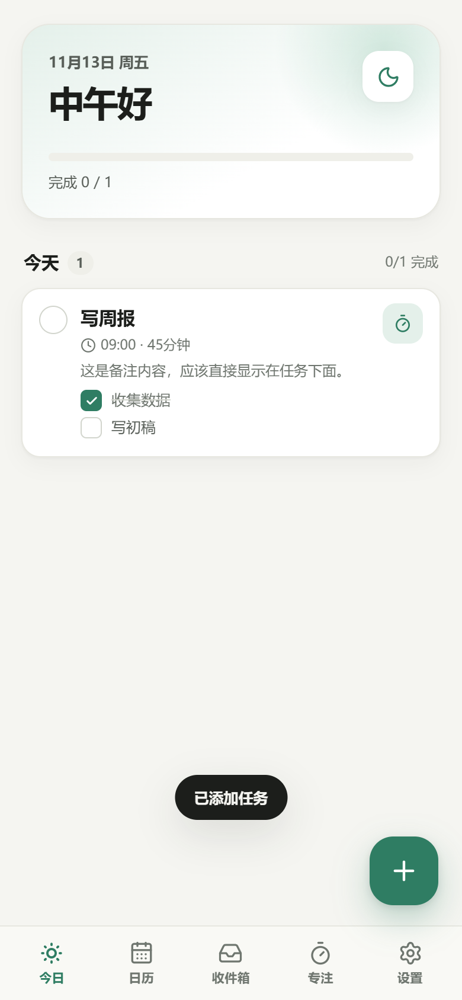

# 今日 · 待办与日历

一个为 iPhone 设计的本地优先待办清单 + 日历 PWA。没有账号、没有服务器，任务保存在浏览器本地；添加到主屏幕后可以像 App 一样全屏使用，也能离线打开。



## 功能

- **今日**：顺延任务、今日任务、完成进度、已完成折叠
- **拖动排序**：长按任务，在同一优先级内拖动；列表按 高 → 中 → 无 排列，但不显示分组框或分组标题
- **任务卡**：直接列出并勾选子任务，备注以低对比度字体显示，带日期/时长的任务有专注计时按钮
- **日历**：周条 + 可展开整月视图；日期圆点、按天查看和添加任务，支持左右滑周、左右切月
- **收件箱**：先记录、后安排日期
- **快速添加**：中文自然语言解析日期 / 时间 / 时长 / 标签
  - 例：`明天下午3点和张三开会 30分钟 #工作`
  - 支持：今天 / 明天 / 后天、周X / 下周X、X月X日、上午9点 / 15:30、半小时 / 1小时 / 30分钟、`#标签`
- **任务字段**：日期、时间、自定义时长、优先级、重复（每天 / 每周 / 工作日）、标签、子任务、备注
- **重复任务**：完成后自动生成下一次
- **日期段任务**：选一个开始和结束日期，区间内每天一条；漏掉不累计；最后一天显示「最后一天！」
- **标签管理**：设置里重命名 / 删除标签；点击任务上的标签直接筛选
- **专注番茄钟**：独立的「专注」tab；任务卡上的计时按钮会带着任务和时长直接开始；可暂停 / 继续，结束只提示完成，不自动勾选
- **顺延**：未完成的历史单日任务会出现在今日视图，可一键移到今天
- **外观**：浅色 / 深色 / 跟随系统，适配 iPhone 安全区
- **数据**：JSON 导出 / 导入备份；导出 `.ics` 到苹果日历
- **PWA**：可安装、离线可用

## 开始使用

```bash
npm install
npm run dev
```

打开 http://localhost:5173 。

构建与本地预览：

```bash
npm run build
npm run preview
```

## 部署到 iPhone

任意支持 HTTPS 的静态托管都可以。构建命令 `npm run build`，输出目录 `dist`。

部署后用 iPhone Safari 打开网址 → 分享 →「添加到主屏幕」。

### GitHub Pages

仓库已内置 `.github/workflows/deploy.yml`，推送到 `main` 后会自动构建并发布：

1. 新建 GitHub 仓库（免费账号需要公开仓库），把代码推到默认分支 `main`
2. 仓库 **Settings → Pages → Build and deployment → Source** 选 **GitHub Actions**
3. 等待 Actions 里的 “Deploy to GitHub Pages” 完成
4. 访问 `https://<用户名>.github.io/<仓库名>/`

工作流会通过 `actions/configure-pages` 自动取得子路径，并注入 `VITE_BASE_PATH`；manifest 的 `start_url` / `scope` 也会跟着调整。工作流同时监听 `main` / `master` 两个分支。

> 国内访问 `github.io` 可能不稳定；必要时换 Cloudflare Pages 或腾讯 EdgeOne Pages。

### 其他平台

- **Cloudflare Pages**：Workers & Pages → Create → Pages → Upload assets，把 `dist` 拖进去
- **EdgeOne Pages（腾讯）**：国内访问更友好，上传 `dist` 或连接仓库
- **Vercel / Netlify**：导入项目或拖拽 `dist`

子路径部署可以手动指定：

```powershell
$env:VITE_BASE_PATH='/myday/'
npm run build
```

不设置时默认根路径 `/`。

> iOS 上，主屏幕版本与 Safari 可能使用相互独立的本地存储。建议先「添加到主屏幕」，再从主屏幕开始记录；如果已经在 Safari 里录入过数据，先在设置里导出备份，再在主屏幕版本中导入。

## 日期段任务怎么工作

在新建任务的「日期」里选择 **日期段**，再选开始和结束日期。保存后：

- 区间内每天生成一条独立任务，所以可以每天单独完成、单独计时、单独勾子任务
- 漏掉的那一天不会进入「顺延」，可以在日历历史里回看并补勾
- 最后一天的任务会显示「最后一天！」
- 编辑某一天只影响这一天；在编辑面板里可以「删除整个时间段」

## 专注计时

- 「专注」tab 可以直接开始 15 / 25 / 45 / 60 分钟的自由计时
- 任务有日期或时长时，任务卡右侧会出现计时按钮；点击后跳到专注页并自动开始，时长优先用任务时长
- 可暂停、继续、结束；计时结束只提示，点「完成任务」才会勾选
- **iOS 限制**：网页 PWA 在锁屏或切后台后会被系统挂起，无法在锁屏时响铃或弹通知。App 会按真实时间校正，并尽量用 Screen Wake Lock 保持屏幕常亮；真正锁屏提醒需要后端 Web Push 或原生 App

## 数据与备份

- 数据保存在浏览器的 IndexedDB 中，只在本机
- 本次升级新增了排序、日期段、标签索引等字段，首次打开会自动做 Dexie 数据迁移，**不会清空现有任务**
- **设置 → 导出备份**：生成 JSON；在 iPhone 上会打开分享面板，可存到「文件」
- **设置 → 导入备份**：覆盖当前数据，并会先弹窗确认；会保留排序、日期段和子任务状态
- **设置 → 导出日历**：生成 `.ics`，可在「文件」中点开导入苹果日历
- 清理 Safari 网站数据会删除任务，建议偶尔导出备份；升级前也可以先备份一次

### 关于提醒

iOS 上的 PWA 没有本地定时通知能力。当前版本不做系统级提醒，有两种替代：

1. 用「导出日历」生成 `.ics`，导入苹果日历后用日历提醒；适合时间固定的任务
2. 后续加一个很小的 Cloudflare Worker + Web Push（iOS 16.4+，且必须先添加到主屏幕）

## 技术栈

- Vite + React 19 + TypeScript
- Dexie（IndexedDB）
- date-fns
- lucide-react
- @dnd-kit（鼠标拖动 + 触摸长按拖动）
- vite-plugin-pwa（Workbox）

## 目录

```
src/
  App.tsx              应用外壳、tab、任务弹层、专注状态调度
  db.ts                Dexie 数据层、迁移、排序、日期段、标签操作
  types.ts             任务类型
  hooks/
    usePomodoro.ts     专注计时、声音、Wake Lock、持久化
  lib/
    dates.ts           日期、排序工具
    parse.ts           中文快速添加解析
    backup.ts          JSON 备份 / 导入 / .ics 导出
    ics.ts             iCalendar 生成
    files.ts           iOS 分享面板 / 文件下载
    theme.ts           主题持久化
  components/          TabBar、TaskItem、TaskSheet、WeekStrip、MonthGrid
  views/               今日 / 日历 / 收件箱 / 专注 / 标签 / 设置
scripts/
  generate-icons.mjs   从 SVG 生成 PWA 图标
  ui-check.mjs         基础 UI 回归（需 dev server）
  feature-check.mjs    新功能端到端自测（需 dev server）
  touch-drag-check.mjs 触摸长按拖动自测（需 dev server）
  db-check.ts          迁移 / 导入 / 数据操作自测（无需服务器）
  pwa-check.mjs        PWA / 离线自测（需 preview server）
.github/workflows/
  deploy.yml           GitHub Pages 自动部署
```

## 自测

启动 dev server 后：

```bash
npm run check:ui        # 原有功能回归
npm run check:features  # 子任务、日期段、标签、月历、拖动、专注
npm run check:touch     # 触摸长按拖动
npm run check:db        # 数据库迁移、备份导入（不需要服务器）
```

PWA 检查：

```bash
npm run build
npm run preview
npm run check:pwa
```

检查 manifest、图标、Service Worker 注册与离线打开。

## 后续可以做

- 番茄钟的休息周期 / 锁屏提醒（需要 Web Push 后端或原生 App）
- 日期段的整段编辑（目前是单天编辑 + 整段删除）
- 搜索、习惯打卡、完成统计 / 热力图
- 多设备同步（Supabase、Cloudflare D1 都可以）
- iOS 主屏小组件（PWA 做不到，需要原生或 Scriptable）
